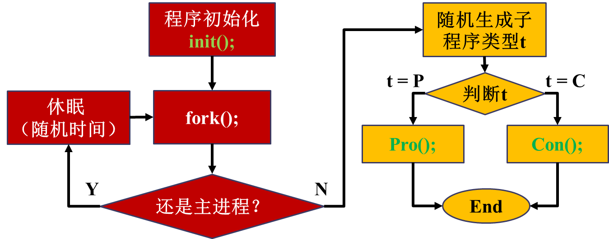
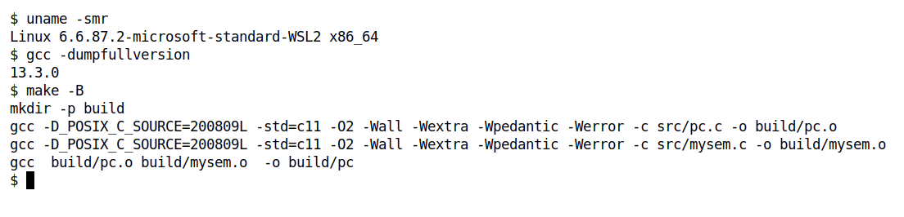
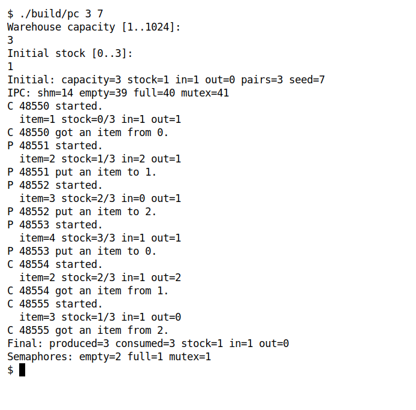
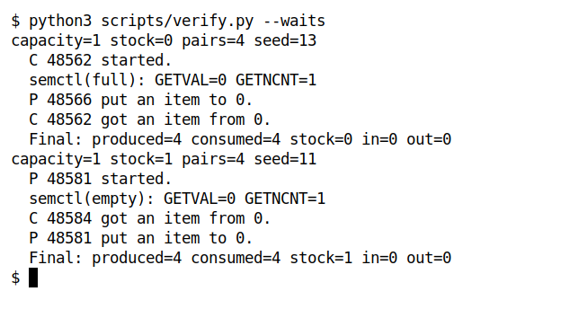
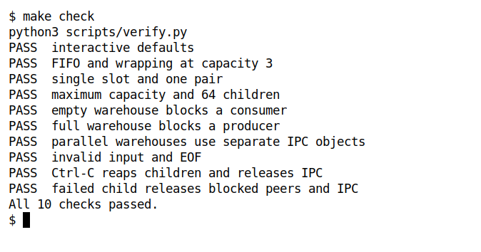

# 实验3 复杂PC问题——信号量与共享存储区

学号　052403137　　姓名　王智壹　　班级　计算机科学与技术5班　　实验日期　2026年11月19日

## 一、实验目的

1. 熟悉 Linux 下的多进程编程。
2. 熟悉 Linux 信号量与共享存储区的使用。
3. 通过多生产者、多消费者共用一个仓库，理解进程之间的同步与互斥。

## 二、实验内容

### 1．建立父进程和子进程

父进程调用 `init()` 建立仓库，再用 `fork()` 创建子进程。两次创建之间随机间隔 10～40 毫秒。每个子进程从剩余名额中随机抽取一个角色，执行一次 `Pro()` 或 `Con()` 后退出。每轮给两种角色分配相同数量的名额。父进程用 `waitpid()` 回收全部子进程，核对库存后释放三个信号量和共享段。

### 2．封装信号量操作

用 `typedef int MySem` 保存信号量集的 ID。每个集合含一个信号量，设置初值和执行 P、V 操作时都使用下标 0。

| 函数 | 实现 |
| --- | --- |
| `MySem newsem(int initVal)` | 用 `semget(IPC_PRIVATE, 1, 0600)` 建集合，调用 `semctl` 的 `SETVAL` 赋初值，再返回 ID。 |
| `void psem(MySem semID)` | `semop` 将值减 1。资源数为 0 时，内核挂起调用进程。 |
| `void vsem(MySem semID)` | `semop` 将值加 1，唤醒符合条件的等待者。 |
| `void freesem(MySem semID)` | `semctl(semID, 0, IPC_RMID)` 删除集合。 |

本次在 WSL2 的 Ubuntu 24.04.2 LTS（x86_64）中运行。用 GCC 13.3.0 按 C11 标准编译两个源文件，链接得到 `build/pc`。

<!-- 分页 -->

### 3．初始化仓库

`init()` 先读取仓库容量 N 和初始库存 S，通过 `shmget` 申请一段共享内存，用 `shmat` 将它映射到父进程。共享段保存仓库数组、库存和两个游标。`out` 从 0 开始，指向下一次读取的位置。`in` 从 S 对 N 取余的位置开始，指向下一次写入的位置。

将编号 1 到 S 的产品依次放入仓库，其余槽位清零。用 `empty = N − S` 记录可用空位，用 `full = S` 记录可取产品，用 `mutex = 1` 保护数组和游标。图 3 中输入 N = 3、S = 1，所以 0 号位已有产品 1，第一次写入从 1 号位开始。

### 4．执行生产和消费

生产者先对 `empty` 做 P，再对 `mutex` 做 P。进入临界区后，把产品写入 `slots[in]`，将 `in` 加 1 并对容量取余。最后依次对 `mutex` 和 `full` 做 V。消费者先对 `full` 做 P，再对 `mutex` 做 P，取出并清空 `slots[out]`，按同样方式推进 `out`，最后依次对 `mutex` 和 `empty` 做 V。

图 3 中，三个生产者把产品 2、3、4 依次写入 1、2、0 号位，写到数组末端后回到开头。三个消费者依次取走产品 1、2、3，最后 0 号位留下产品 4。此时库存为 1，空位为 2，`in = 1`、`out = 0`，与终端末两行一致。

<!-- 分页 -->

### 5．观察空仓和满仓时的等待

把容量设为 1，分别从空仓和满仓启动。用 `semctl` 的 `GETVAL` 读取资源数量，用 `GETNCNT` 读取正在等待该信号量增加的进程数。

<!-- 图文并排 -->

空仓时，先到的消费者在 `full` 上等待。此时资源数为 0，等待数为 1。生产者把产品放入 0 号位后，该消费者取走产品。满仓时，先到的生产者在 `empty` 上等待，直到消费者腾出 0 号位才写入。两种情况下，等待资源的进程都把互斥锁留给了另一方。

<!-- 图文并排 -->

用 `make check` 逐次核对进程号、产品编号、槽位和库存。另开两个仓库同时运行，核对各自的 IPC 标识。正常结束、按 Ctrl+C 和子进程异常退出后，均在内核 IPC 表中核对本轮对象已回收。

## 三、思考与实践

### 1．fork() 怎样工作？父子进程怎样共享信息？

一次成功的 `fork()` 会从调用点返回两次。父进程得到子进程的 PID，子进程得到 0，创建失败时调用者得到 −1。普通变量随进程地址空间按写时复制处理，各进程单独修改自己的副本。本实验在 `fork()` 前完成 `shmat`，子进程继承映射和信号量 ID，因此各进程访问同一份仓库。它们通过互斥信号量依次更新数组、库存和游标。

### 2．独立启动的程序怎样取得并使用同一个 IPC 对象？

双方约定同一个已存在的文件，用 `ftok` 配合两个项目标识分别生成共享内存键和信号量键。创建方以 `IPC_CREAT | IPC_EXCL | 0600` 标志调用 `shmget` 和 `semget`，初始化仓库和信号量，再通知参与方就绪。

参与方用相同的键调用 `shmget` 和 `semget` 取得已有 ID，用 `shmat` 建立自己的映射。若把三个信号量放入同一集合，双方约定空位、产品、互斥锁的下标，按第 4 步的顺序做 P、V。结束时各进程用 `shmdt` 解除映射，创建方在所有参与方退出后用 `shmctl` 和 `semctl` 的 `IPC_RMID` 删除对象。
