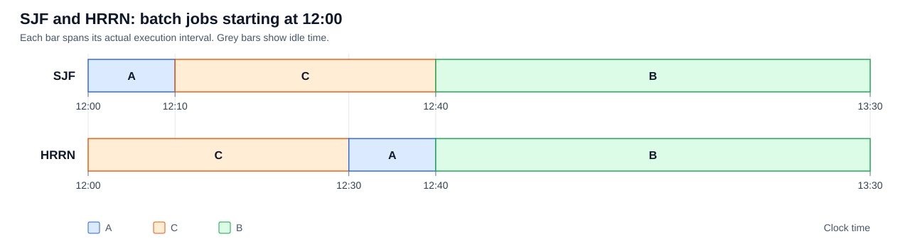
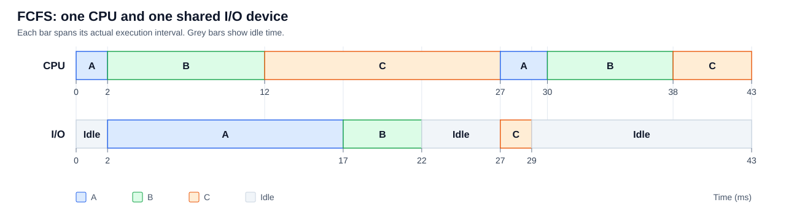
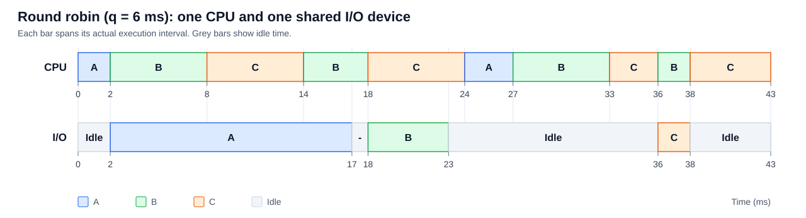
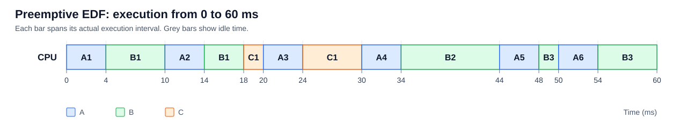
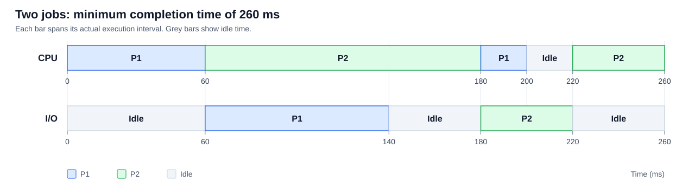

# 第 4 章：处理机调度

题目来源：[4_ProcessorScheduling.pdf](../../../../ppt/4_ProcessorScheduling.pdf#page=40)，PDF 第 40～44 页。以下保留题目条件，并按课件顺序作答。

周转时间与带权周转时间分别为：

$$
T_i=完成时刻_i-提交时刻_i,\qquad W_i=\frac{T_i}{服务时间_i}
$$

$$
\overline T=\frac{1}{n}\sum_{i=1}^{n}T_i,\qquad
\overline W=\frac{1}{n}\sum_{i=1}^{n}W_i
$$

所有时序图中的区间均为左闭右开，灰色表示设备空闲；未特别说明时，忽略调度与切换开销。

## 一、调度作业 1（p40）：SJF 与 HRRN

### 题目

某脱机单道批处理系统有三道作业 A、B、C，其提交时间及所需服务时间如下。若 12:00 开始调度，分别采用短作业优先算法和高响应比优先算法，画出调度时序图，计算平均周转时间和平均带权周转时间。

| 作业 | 提交时间 | 服务时间 |
| --- | --- | --- |
| A | 11:30 | 10 分钟 |
| B | 10:00 | 50 分钟 |
| C | 10:20 | 30 分钟 |

课件文字写有“A、B、C 依次到达”，但表中提交时间并非这一顺序；以下以表内明确给出的时刻为准。12:00 时三道作业均已到达，周转时间从各自提交时刻起算。

### （1）短作业优先算法 SJF

按服务时间从短到长选择作业，执行顺序为 **A → C → B**。

| 运行区间 | 作业 |
| --- | --- |
| 12:00～12:10 | A |
| 12:10～12:40 | C |
| 12:40～13:30 | B |

| 作业 | 完成时刻 | 周转时间 $T_i$（分钟） | 带权周转时间 $W_i$ |
| --- | --- | --- | --- |
| A | 12:10 | $40$ | $40/10=4$ |
| B | 13:30 | $210$ | $210/50=4.2$ |
| C | 12:40 | $140$ | $140/30=14/3$ |

$$
\overline T_{SJF}=\frac{40+210+140}{3}=\boxed{130\text{ 分钟}}
$$

$$
\overline W_{SJF}=\frac{4+4.2+14/3}{3}
=\frac{193}{45}\approx\boxed{4.289}
$$

### （2）高响应比优先算法 HRRN

响应比为 $R=(等待时间+服务时间)/服务时间=1+等待时间/服务时间$。每次作业完成后，重新计算其余作业的响应比，选择最大者。

| 调度时刻 | A 的响应比 | B 的响应比 | C 的响应比 | 选择 |
| --- | --- | --- | --- | --- |
| 12:00 | $(30+10)/10=4$ | $(120+50)/50=3.4$ | $(100+30)/30=13/3$ | C |
| 12:30 | $(60+10)/10=7$ | $(150+50)/50=4$ | 已完成 | A |
| 12:40 | 已完成 | $(160+50)/50=4.2$ | 已完成 | B |

执行顺序为 **C → A → B**。

| 运行区间 | 作业 |
| --- | --- |
| 12:00～12:30 | C |
| 12:30～12:40 | A |
| 12:40～13:30 | B |

| 作业 | 完成时刻 | 周转时间 $T_i$（分钟） | 带权周转时间 $W_i$ |
| --- | --- | --- | --- |
| A | 12:40 | $70$ | $70/10=7$ |
| B | 13:30 | $210$ | $210/50=4.2$ |
| C | 12:30 | $130$ | $130/30=13/3$ |

$$
\overline T_{HRRN}=\frac{70+210+130}{3}
=\frac{410}{3}\approx\boxed{136.667\text{ 分钟}}
$$

$$
\overline W_{HRRN}=\frac{7+4.2+13/3}{3}
=\frac{233}{45}\approx\boxed{5.178}
$$

两种算法的调度时序图如下，横轴为实际时刻：

## 二、调度作业 2（p41）：FCFS 与时间片轮转

### 题目与计算约定

进程 A、B、C 依次开始执行，各自的业务流程如下：

| 进程 | 第一段 CPU | I/O | 第二段 CPU |
| --- | --- | --- | --- |
| A | 2 ms | 15 ms | 3 ms |
| B | 10 ms | 5 ms | 8 ms |
| C | 15 ms | 2 ms | 5 ms |

三个进程使用**同一台独占 I/O 设备**，设备按 FCFS 原则分配。分别采用 FCFS 和时间片为 6 ms 的 RR 调度，画出运行时序图并计算平均周转时间。

题目未单列到达时刻，以下按三个进程在 $t=0$ 同时到达、初始就绪队列为 A → B → C 计算。进程完成 I/O 后进入就绪队列队尾；CPU 与 I/O 设备可以并行工作。

### （1）先来先服务算法 FCFS

CPU 按进入就绪队列的先后顺序选择进程，当前 CPU 段执行完毕才切换。

| CPU 运行区间（ms） | 进程 | 说明 |
| --- | --- | --- |
| 0～2 | A | 完成第一段 CPU，转去 I/O |
| 2～12 | B | 完成第一段 CPU，等待 I/O 设备 |
| 12～27 | C | 连续完成第一段 CPU |
| 27～30 | A | 完成第二段 CPU，结束 |
| 30～38 | B | 完成第二段 CPU，结束 |
| 38～43 | C | 完成第二段 CPU，结束 |

| I/O 服务区间（ms） | 进程 | 说明 |
| --- | --- | --- |
| 2～17 | A | 17 ms 时进入就绪队列 |
| 17～22 | B | 12 ms 提出请求，先等待 5 ms；22 ms 时就绪 |
| 27～29 | C | 29 ms 时就绪，排在 B 后面 |

I/O 设备在 0～2、22～27、29～43 ms 空闲。

三道进程的完成时刻分别为 30、38、43 ms，到达时刻均为 0，因此：

$$
\overline T_{FCFS}=\frac{30+38+43}{3}=\boxed{37\text{ ms}}
$$

### （2）时间片轮转 RR，$q=6\text{ ms}$

进程用完时间片后进入就绪队列队尾；如果本段 CPU 提前完成，则立即阻塞或结束，下一个进程获得新的完整时间片。

| CPU 运行区间（ms） | 进程 | 区间结束时的情况 |
| --- | --- | --- |
| 0～2 | A | 第一段 CPU 完成，I/O 从 2 ms 开始 |
| 2～8 | B | 第一段 CPU 还剩 4 ms，进入队尾 |
| 8～14 | C | 第一段 CPU 还剩 9 ms，进入队尾 |
| 14～18 | B | 第一段 CPU 完成，I/O 从 18 ms 开始 |
| 18～24 | C | 第一段 CPU 还剩 3 ms，进入队尾 |
| 24～27 | A | 第二段 CPU 完成，进程结束 |
| 27～33 | B | 第二段 CPU 还剩 2 ms，进入队尾 |
| 33～36 | C | 第一段 CPU 完成，I/O 从 36 ms 开始 |
| 36～38 | B | 第二段 CPU 完成，进程结束 |
| 38～43 | C | 第二段 CPU 完成，进程结束 |

| I/O 服务区间（ms） | 进程 |
| --- | --- |
| 2～17 | A |
| 18～23 | B |
| 36～38 | C |

I/O 设备在 0～2、17～18、23～36、38～43 ms 空闲。本次轮转调度中，三次 I/O 请求到达时设备均空闲。

A 在 17 ms 完成 I/O 时排在就绪进程 C 后面，因此 18 ms 先运行 C。B 在 23 ms 完成 I/O 后排在 A 后面；24 ms 时 C 用完时间片再入队，此时队列为 A → B → C。

$$
T_A=27\text{ ms},\quad T_B=38\text{ ms},\quad T_C=43\text{ ms}
$$

$$
\overline T_{RR}=\frac{27+38+43}{3}=\boxed{36\text{ ms}}
$$

## 三、调度作业 3（p42）：周期任务的时限调度

### 题目

某实时系统采用时限调度算法，处理 A、B、C 三类周期性任务。发生周期分别为 10、22、36 ms，单次处理时间分别为 4、10、8 ms。

1. 画出 60 ms 前的调度图。
2. 判断这组任务是否可调度，并说明理由。

### （1）0～60 ms 的调度过程

按课件 p37～p38 的定义，采用**抢占式最早截止时间优先算法（EDF）**，每次选择绝对截止时间最近的已就绪任务。设三类任务首次均在 0 ms 释放，每个任务的截止时间为下一周期的开始时刻。

用 $A_k$ 表示 A 类任务的第 $k$ 次实例，B、C 类同理。

| 任务实例 | 释放时刻（ms） | 截止时刻（ms） | 所需 CPU 时间（ms） |
| --- | --- | --- | --- |
| $A_1,A_2,A_3,A_4,A_5,A_6$ | $0,10,20,30,40,50$ | $10,20,30,40,50,60$ | 每次 4 |
| $B_1,B_2,B_3$ | $0,22,44$ | $22,44,66$ | 每次 10 |
| $C_1,C_2$ | $0,36$ | $36,72$ | 每次 8 |

| 运行区间（ms） | 任务 | 该任务的截止时刻（ms） |
| --- | --- | --- |
| 0～4 | $A_1$ | 10 |
| 4～10 | $B_1$ | 22 |
| 10～14 | $A_2$ | 20 |
| 14～18 | $B_1$ | 22 |
| 18～20 | $C_1$ | 36 |
| 20～24 | $A_3$ | 30 |
| 24～30 | $C_1$ | 36 |
| 30～34 | $A_4$ | 40 |
| 34～44 | $B_2$ | 44 |
| 44～48 | $A_5$ | 50 |
| 48～50 | $B_3$ | 66 |
| 50～54 | $A_6$ | 60 |
| 54～60 | $B_3$ | 66 |

在 40 ms 时，虽然 $A_5$ 已释放，但 $B_2$ 的截止时间 44 ms 早于 $A_5$ 的 50 ms，所以 $B_2$ 继续运行。60 ms 前，$A_1$～$A_6$、$B_1$、$B_2$、$C_1$ 均已按时完成；$B_3$ 还剩 2 ms，$C_2$ 尚未运行、还需 8 ms。恰在 60 ms 释放的 $A_7$ 属于后续调度。

### （2）是否可调度

总处理器利用率为：

$$
U=\frac{4}{10}+\frac{10}{22}+\frac{8}{36}
=\frac{533}{495}\approx1.0768>1
$$

所需计算量超过单处理器的长期处理能力，因此**这组任务不可调度**。

也可以考察截止时间不晚于 72 ms 的任务：共有 7 个 A 类、3 个 B 类、2 个 C 类任务，需要：

$$
7\times4+3\times10+2\times8=74\text{ ms}>72\text{ ms}
$$

因此，即使前 60 ms 尚未出现超期，也不可能保证全部任务按时完成。若继续上述 EDF 调度，60～62 ms 完成 $B_3$，62～66 ms 完成 $A_7$，随后运行 $C_2$；到其截止时刻 72 ms 时仍剩 2 ms 未执行，首次出现超期。

## 四、调度测试题 1（p43）：两个作业的最短完成时间

### 题目

某多道批处理系统只有 P1、P2 两个作业，P2 比 P1 晚 5 ms 到达，执行顺序如下：

- P1：计算 60 ms → I/O 80 ms → 计算 20 ms。
- P2：计算 120 ms → I/O 40 ms → 计算 40 ms。

不考虑调度与切换时间，完成两个作业至少需要多少时间？

A. 240 ms；B. 260 ms；C. 340 ms；D. 360 ms。

### 解答

**选择 B，最短时间为 260 ms。** 以 P1 到达时刻为 0，可采用下列安排：

| 时间区间（ms） | CPU | I/O |
| --- | --- | --- |
| 0～60 | P1 第一段计算 | 空闲 |
| 60～140 | P2 第一段计算 | P1 |
| 140～180 | P2 继续第一段计算，P1 已就绪等待 | 空闲 |
| 180～200 | P1 第二段计算，200 ms 完成 | P2 |
| 200～220 | 空闲 | P2 |
| 220～260 | P2 第二段计算，260 ms 完成 | 空闲 |

P2 在 5 ms 时到达后等待，60 ms 开始使用 CPU。CPU 与 I/O 的并行使两个作业在 260 ms 时全部完成。

为证明这已经是最短时间，考察两个作业的第一段 CPU 计算：其总量为 $60+120=180$ ms，所以两者不可能在 180 ms 以前全部完成。最后完成第一段计算的那个作业，之后仍必须依次进行自己的 I/O 和末段计算；P1 需要 $80+20=100$ ms，P2 需要 $40+40=80$ ms。因此任何调度都有：

$$
完成全部作业的时间\ge180+\min(100,80)=260\text{ ms}
$$

上述安排达到此下界，故最短时间确为 260 ms。

## 五、调度测试题 2（p44）：动态优先数与饥饿

### 题目

调度程序每次选择优先数最大的进程运行。用户在进程创建时指定静态优先数 `nice`；`cpuTime` 和 `waitTime` 初始值均为 0，按以下规则更新：

- 执行态：`cpuTime` 定时加 1，`waitTime` 置 0。
- 就绪态：`cpuTime` 置 0，`waitTime` 定时加 1。

1. 若 `priority = nice`，为什么可能出现饥饿？
2. 使用 `nice`、`cpuTime`、`waitTime` 设计避免饥饿的动态优先数计算方法，并说明 `waitTime` 的作用。

### （1）静态优先数可能导致饥饿的原因

`nice` 一经确定便不随等待时间变化。如果高优先数进程持续处于就绪或执行状态，或者不断有高优先数的新进程到达，低优先数进程即使已经等待很久，也始终无法被选中，从而长期得不到 CPU，产生饥饿。

### （2）动态优先数的设计

可取：

$$
\boxed{priority=nice+waitTime-cpuTime}
$$

更一般地，也可取 $priority=nice+\alpha\,waitTime-\beta\,cpuTime$，其中 $\alpha,\beta>0$。

- `nice` 保留用户设定的基本优先关系。
- `waitTime` 越大，优先数越高，使长期等待的进程逐渐获得运行机会，即优先级老化。
- `cpuTime` 越大，优先数越低，使连续占用 CPU 的进程逐渐让出处理器。

当进程开始运行时，`waitTime` 清零；再次进入就绪态时，`cpuTime` 清零，重新累计等待时间。因此，每次等待都会提高其获得 CPU 的机会。

在 `nice` 取值有界、定时重新调度、等待计数不会因溢出或截断而失效的通常条件下，长期等待的进程能够逐渐超过高静态优先数的进程；同优先数时再按 FCFS 或轮转选择，可以避免进程因优先数过低而一直饥饿。
